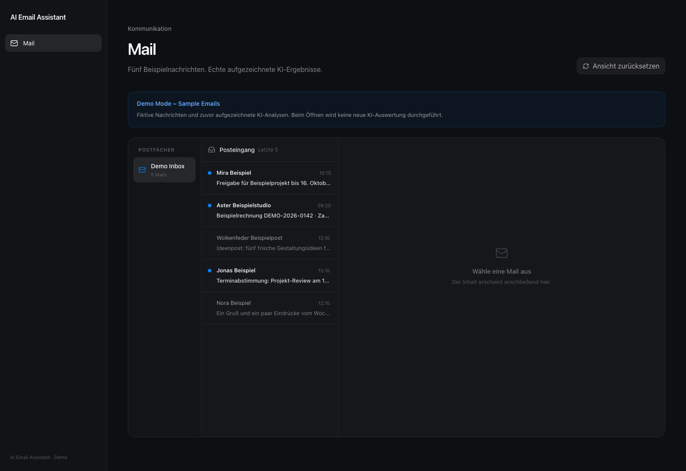
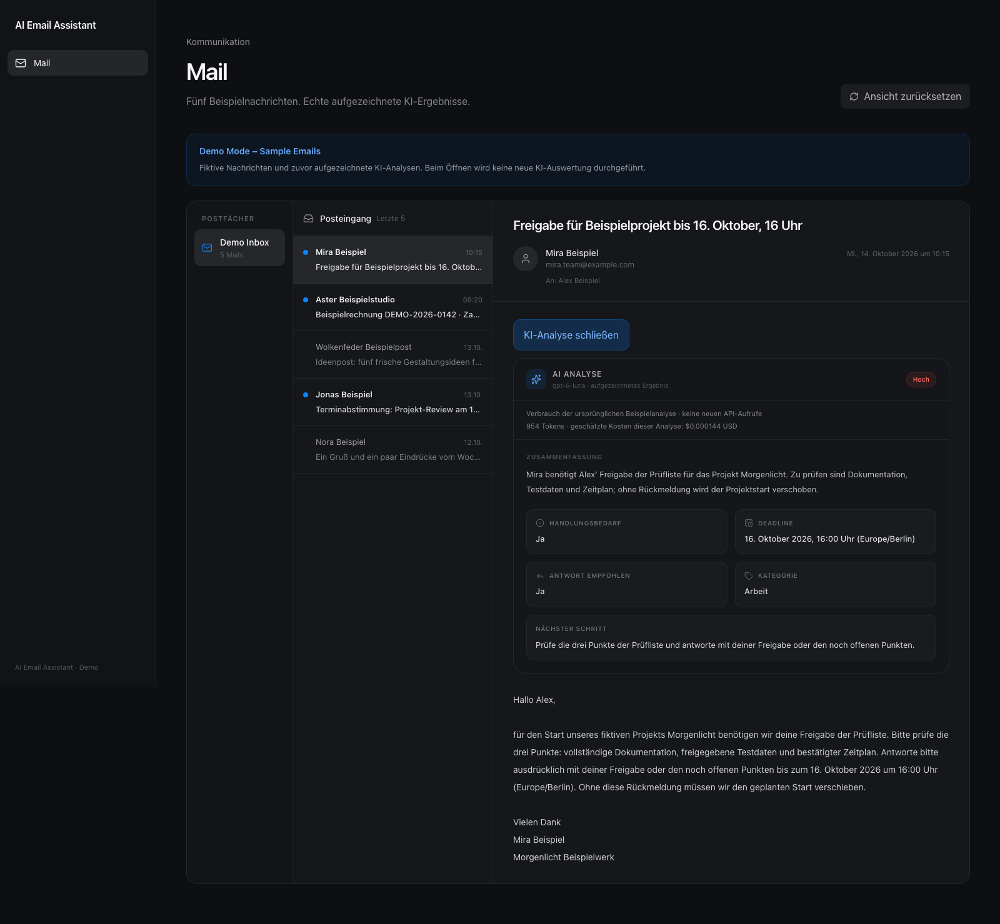
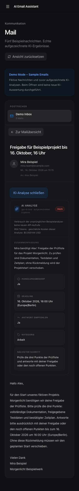

# AI Email Assistant

A personal email workspace built with Next.js, TypeScript and OpenAI. Read two
IMAP inboxes in one dark interface and turn messages into structured summaries,
priorities, deadlines and next steps.

**[Try the interactive demo →](https://max-ai-proxy.github.io/AI-Email-Assistant/)**
No account, installation or API key required. The demo runs entirely in your
browser with five fictional emails and genuine, previously recorded AI analyses.
Opening an analysis never makes a new model request.



<details><summary>Mobile reading view</summary>



</details>

## Features

- Two read-only IMAP inboxes: T-Online and TU Braunschweig.
- Full parsed message text, sender, recipients, date, unread status and attachment metadata.
- German AI summaries, importance, required action, deadlines, reply recommendations and categories.
- Local analysis reuse, token/cost recording and automatic detection of new T-Online mail.
- Shared desktop/mobile mail interface for live use and the static demo.

## Why I built it

This project started as my personal mail application: I wanted private and
university email in one workspace and a clearer view of what needed attention.
The public repository contains the complete productive mail and AI application
code, with no personal credentials, private emails or personal analysis history.
The portfolio demo uses independently written fictional messages and the actual
validated results of five one-time OpenAI calls. The interface is German;
this documentation is English.

## Architecture

| Mode | Entry/build | Data and execution |
| --- | --- | --- |
| Live, local | Next.js `/mail`, `npm run build` | Node route handlers → IMAP over TLS; OpenAI Responses API; private local JSON storage |
| Static demo | `demo/src/main.tsx`, `npm run build:demo` | Vite → `demo/dist`; bundled fictional messages and recorded results; no backend |

Both modes render `AppShell`, `MailWorkspace` and `MailAnalysisCard`. The static
entry imports no live fetch adapter, server modules or credentials. A Content
Security Policy with `connect-src 'none'` blocks fetch, WebSocket and other data
connections. Assets use the `/AI-Email-Assistant/` GitHub Pages base path. There
are no analytics, external fonts, tracking or remote email images.

Live handlers parse MIME with MailParser and use ImapFlow with read-only mailbox
locks. OpenAI and persistence modules are marked `server-only`. APIs reject
remote hosts and cross-origin browser requests, and return private, non-cacheable
responses. This is a local single-user application, without public authentication.
Run the live app on loopback; GitHub Pages hosts only the static demo.

Technology: Next.js App Router, React 19, TypeScript, Tailwind CSS 4, Lucide,
ImapFlow, MailParser, OpenAI SDK, Vite, Vitest and Playwright. Node.js **24+** is
required; exact dependencies are locked in `package-lock.json`.

## Install and run the live application

```bash
git clone https://github.com/MAX-AI-proxy/AI-Email-Assistant.git
cd AI-Email-Assistant
npm ci
cp .env.example .env.local
```

Edit `.env.local` with your own credentials. Leave unused accounts blank.
Never use a `NEXT_PUBLIC_` prefix for secrets.

| Variable | Purpose |
| --- | --- |
| `T_ONLINE_EMAIL` | Full T-Online address |
| `T_ONLINE_APP_PASSWORD` | Provider-approved IMAP/app password |
| `TU_EMAIL_ADDRESS` | TU Braunschweig address |
| `TU_EMAIL_USERNAME` | Institutional IMAP login |
| `TU_EMAIL_PASSWORD` | Institutional IMAP password |
| `OPENAI_API_KEY` | Your own OpenAI API key |
| `MAX_AI_AUTO_ANALYSIS` | Set `false` to disable background analysis; retained for compatibility |

The fixed provider adapters connect to `secureimap.t-online.de` and
`mail.tu-braunschweig.de` over TLS on port 993. Check your provider's current
IMAP availability and authentication requirements. Restart after configuration
changes.

```bash
npm run dev
# Or:
npm run build
npm run start
```

Open http://127.0.0.1:3000. `/` opens `/mail`. Missing credentials produce a
configuration hint. Opening T-Online mail automatically analyzes it if no cached
result exists and can incur API charges even with background analysis disabled.
University mail is read-only without AI analysis. No mail is sent or modified.

## AI and private storage

The existing analyzer calls `gpt-6-luna` with strict JSON-schema output,
`reasoning.effort: none` and `store: false`, then validates all returned fields.
Its instructions treat email content as untrusted and distinguish explicit
deadlines from vague urgency. AI results can still be wrong: check the original
message before making decisions.

Live message text and metadata are sent to OpenAI. `store: false` does not mean
zero provider retention; see [OpenAI data controls](https://developers.openai.com/api/docs/guides/your-data).

Private `.max-ai-data/<account-hash>/` files store analysis caches, token/cost
logs and automatic-analysis state. Files use owner-only POSIX permissions but
are unencrypted. Keep this ignored directory private. To clear history, stop
the local app and remove it locally.

While the app is open, configured background analysis polls roughly once a
minute with up to two workers. The first poll establishes a baseline; later
new UIDs are queued within the latest 100 T-Online messages. Cached content is
reused and duplicate requests share a job within one server process.

Displayed USD costs are estimates calculated from actual token usage, not
billing records. The recorded demo cost is the original generation estimate,
not a charge incurred by viewing the demo. Rates are centralized in the analyzer;
see the [official model page](https://developers.openai.com/api/docs/models/gpt-6-luna).

## Static demo and deployment

```bash
npm run build:demo
npm run preview:demo
```

Open http://127.0.0.1:3200/AI-Email-Assistant/. These commands require no secrets
and never regenerate AI results. `check:demo` verifies the five saved results,
usage fields and their SHA-256 binding to the fictional messages before building.

The one-time generator is deliberately separate from builds and CI. It requires
explicit approval, a temporary local `.env.local` key and
`npm run generate:demo -- --approved-five-calls`. A private journal reserves each
attempt before sending it, caps execution at five attempts across reruns, and
disables SDK retries. Failed attempts are not silently replaced with made-up
results or repeated calls. Successful completion removes the temporary key file.
Never regenerate automatically in a deployment workflow.

The `Checks` GitHub Actions workflow verifies both apps and the publication set,
then uploads **only `demo/dist`** and deploys it to GitHub Pages on successful
`main` pushes. Repository Settings → Pages → Build and deployment → Source must
be **GitHub Actions**. No IMAP credentials or OpenAI secrets are needed in CI.

## Verification and public-file controls

```bash
npm run typecheck
npm run lint
npm test
npm run build
npm run build:demo
npx playwright install chromium --only-shell
npm run test:e2e
npm run test:demo
npm audit --omit=dev
npm run export:public
npm run audit:public -- MAX-AI_Public
npm run audit:staged
```

Live unit and browser tests use mocks and fictional messages, with runtime
credentials explicitly blank. Demo browser tests open all five messages, compare
all displayed analyses with the saved API results, check mobile navigation and
reject API or external-origin requests. No paid calls or real mail access occur
during tests or public demo visits.

The export uses `scripts/public-files.json`, refuses an existing output folder
and copies no Git history, secret files or runtime data. `PUBLIC_MANIFEST.json`
binds each allowlisted file to its size and SHA-256. `audit:staged` independently
reads the actual Git index blobs and checks the complete publishable tree.
Only three explicitly allowlisted, visually reviewed PNG screenshots are accepted;
PNG metadata and arbitrary binaries remain forbidden. Refresh the manifest with
`npm run manifest:public` after reviewed source changes, before staging.

See [the release report](docs/RELEASE_REPORT.md) and [security notes](SECURITY.md).

## Limitations

- Latest 100 T-Online / 20 university messages; no full mailbox synchronization.
- No folders, paging, sending, deleting, attachment downloads, OAuth or general account management.
- Importance is displayed per message; no priority sorting or automated actions.
- Background analysis requires an open browser; UIDVALIDITY resets require clearing local state.
- Local JSON queues and duplicate suppression assume a single Node server process.
- Mock checks do not certify a user's live provider credentials or entitlement.
- The demo is deliberately static and cannot accept uploads or analyze new mail.
- No project license has been selected; public visibility alone grants no additional reuse rights.
